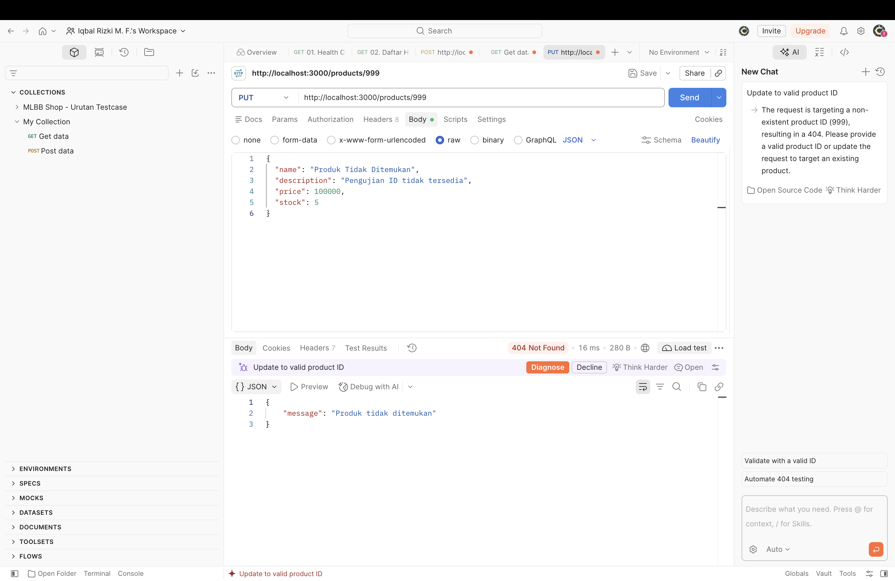
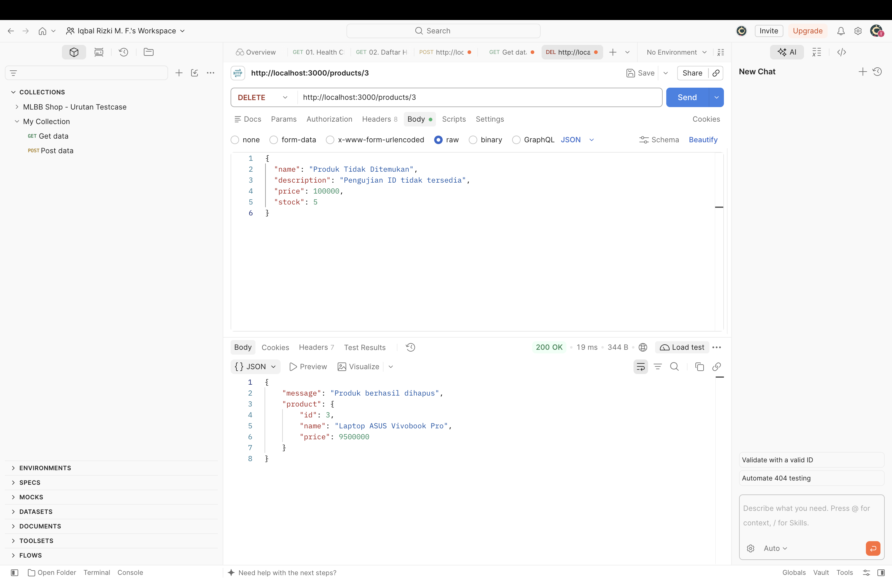
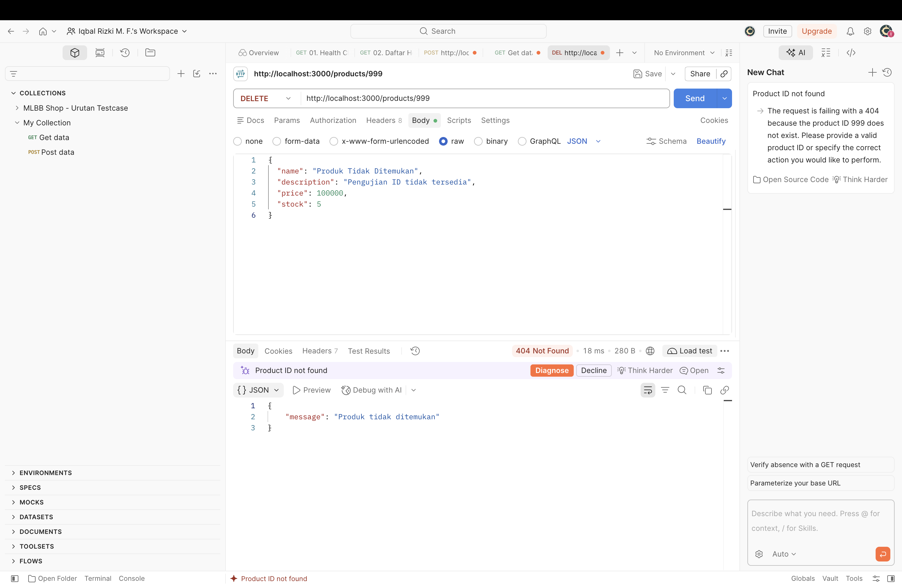

# Laporan Evidence — Products API

**Nama:** Iqbal Rizki Muhammad Fadhli
**NRP:** 5027251027
**Kelas:** C

## Ringkasan

API mengelola data produk melalui Express, Prisma, dan PostgreSQL. Laporan ini mencakup alur sukses, validasi input, data tidak ditemukan, serta perubahan record database. Koleksi request dapat diimpor dari [`postman/Products API.postman_collection.json`](postman/Products%20API.postman_collection.json).

> Sisipkan screenshot asli dari Postman, Bruno, atau Hoppscotch pada slot di bawah. Pastikan method, URL, request body, status HTTP, dan response terlihat. Untuk bukti database, gunakan Prisma Studio atau hasil query SQL dengan database yang sama.

## 1. Persiapan pengambilan bukti

Ikuti persiapan pada README: siapkan `.env`, pasang dependency, generate Prisma Client, terapkan migration, jalankan seed, lalu jalankan `npm start`. Gunakan `http://localhost:3000`. Impor koleksi Postman yang disertakan. Koleksi memakai ID dari response POST (`productId`) agar update dan delete diarahkan ke record uji yang dibuat dalam sesi tersebut.

Ambil snapshot database awal sebelum menjalankan request yang mengubah data. Skenario POST dan PUT menyentuh record baru yang dibuat oleh request POST pada koleksi; DELETE menghapus record uji itu. Record awal seperti Buku dan Pulpen tidak perlu diubah.

## 2. Evidence request API

### 2.1 GET seluruh produk — `200 OK`

Jalankan `GET /products`. Hasil yang diharapkan berupa array produk.

**Screenshot Postman/Bruno/Hoppscotch:**


### 2.2 GET ID tidak valid — `400 Bad Request`

Jalankan `GET /products/abc`. API menolak ID yang bukan bilangan bulat positif.

**Screenshot:**


### 2.3 POST produk — `201 Created`

Body: `{"name":"Produk Evidence","price":7000}`. Simpan nilai `id` dari response; koleksi menyimpannya sebagai `productId` untuk skenario update/delete.

**Screenshot:**


### 2.4 POST gagal validasi — `400 Bad Request`

Kirim `{"name":"Produk tanpa harga"}`. API harus menolak request karena `price` wajib berupa angka non-negatif.

**Screenshot:**


### 2.5 PUT produk uji — `200 OK`

Perbarui ID hasil POST dengan body `{"name":"Produk Evidence Diubah","price":8500}`. Response harus memperlihatkan nama dan harga baru.

**Screenshot:**


### 2.6 PUT ID tidak ditemukan — `404 Not Found`

Kirim PUT ke `/products/999999` dengan body valid. API harus mengembalikan pesan produk tidak ditemukan.

**Screenshot:**


### 2.7 DELETE produk uji — `200 OK`

Hapus ID hasil POST. Response memuat data produk yang dihapus.

**Screenshot:**


### 2.8 DELETE ID tidak ditemukan — `404 Not Found`

Kirim DELETE ke `/products/999999`. API harus mengembalikan pesan produk tidak ditemukan.

**Screenshot:**


## 3. Evidence perubahan database

Gunakan Prisma Studio (`npm run prisma:studio`) pada model `Product`, atau jalankan query berikut di pgAdmin/klien PostgreSQL. Tampilkan data sebelum POST, setelah POST, setelah PUT, dan setelah DELETE. Record ID hasil POST menjadi record pembanding.

### 3.1 Sebelum POST

Jalankan query sebelum skenario POST:

```sql
SELECT id, name, price FROM "Product" ORDER BY id;
```

**Screenshot Prisma Studio / hasil query:**


### 3.2 Sesudah POST

Refresh Prisma Studio atau jalankan query yang sama. Catat ID yang muncul untuk `Produk Evidence`.

**Screenshot:**


**Perubahan:** jumlah record bertambah satu; record baru memiliki nama `Produk Evidence` dan harga `7000`.

### 3.3 Sesudah PUT

Refresh data. Record dengan ID hasil POST kini bernama `Produk Evidence Diubah` dengan harga `8500`.

**Screenshot:**


**Perubahan:** record yang sama berubah nama dan harganya.

### 3.4 Sesudah DELETE

Refresh data. Pastikan ID hasil POST sudah tidak ada.

**Screenshot:**


**Perubahan:** record uji terhapus; data awal lainnya tetap ada.

## 4. Catatan hasil aktual

Isi status, response, dan waktu aktual setelah menjalankan request dan mengambil screenshot. Jangan menandai bukti sebagai terlampir sebelum file screenshot asli disimpan di folder `evidence/`.

| Skenario | Status aktual | File screenshot |
|---|---:|---|
| GET seluruh produk |  | `evidence/01-get-products.png` |
| GET ID tidak valid |  | `evidence/02-get-invalid-id.png` |
| POST berhasil |  | `evidence/03-post-created.png` |
| POST validasi gagal |  | `evidence/04-post-validation-error.png` |
| PUT berhasil |  | `evidence/05-put-updated.png` |
| PUT tidak ditemukan |  | `evidence/06-put-not-found.png` |
| DELETE berhasil |  | `evidence/07-delete-success.png` |
| DELETE tidak ditemukan |  | `evidence/08-delete-not-found.png` |

## 5. Kesimpulan

Lengkapi kesimpulan berdasarkan hasil aktual. Bukti yang lengkap menunjukkan hasil tiap skenario API dan perubahan record yang sama pada database sebelum POST, setelah POST, setelah PUT, dan setelah DELETE.
